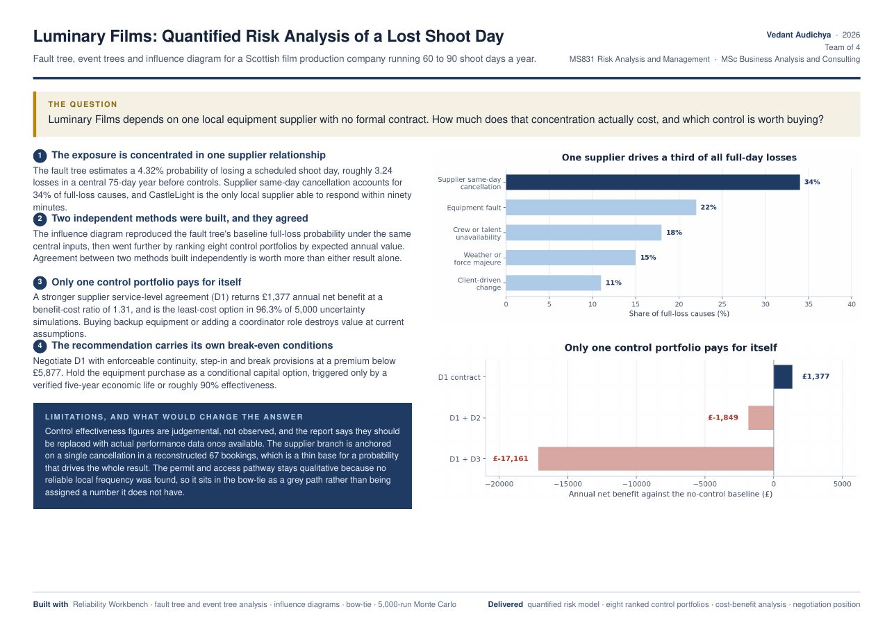

# Luminary Films: Quantified Risk Analysis of a Lost Shoot Day

> Luminary Films depends on one local equipment supplier with no formal contract. How much does that concentration actually cost, and which control is worth buying?

| | |
|---|---|
| **Role** | Team of 4 |
| **Context** | MS831 Risk Analysis and Management · MSc Business Analysis and Consulting, University of Strathclyde · 2026 |
| **Business** | Scottish film production company running 60–90 shoot days a year |
| **Methods** | Reliability Workbench · fault tree and event tree analysis · influence diagrams · bow-tie · 5,000-run Monte Carlo |

## Key findings

1. **The exposure is concentrated in one supplier relationship.** The fault tree estimates a **4.32%** probability of losing a scheduled shoot day, roughly **3.24 losses** in a central 75-day year before controls. Supplier same-day cancellation accounts for **34%** of full-loss causes.
2. **Two independent methods were built, and they agreed.** The influence diagram reproduced the fault tree's baseline full-loss probability, then ranked eight control portfolios by expected annual value.
3. **Only one control portfolio pays for itself.** A stronger supplier service-level agreement (D1) returns **£1,377** annual net benefit at a benefit-cost ratio of **1.31**, and is the least-cost option in **96.3% of 5,000** simulations. Adding backup equipment (D1 + D2: −£1,849) or a coordinator role (D1 + D3: −£17,161) destroys value.
4. **The recommendation carries its own break-even conditions.** Negotiate D1 with continuity, step-in and break provisions at a premium below **£5,877**. Hold the equipment purchase as a conditional capital option, triggered only by a verified five-year life or roughly 90% effectiveness.

| Cause of a lost shoot day | Share |
|---|---|
| Supplier same-day cancellation | 34% |
| Equipment fault | 22% |
| Crew or talent unavailability | 18% |
| Weather or force majeure | 15% |
| Client-driven change | 11% |

A full loss costs £3,600–£8,300, plus a £3,000–£8,000 client penalty on Tier 1 days.

## Limitations

- Control effectiveness figures are judgemental, not observed, and should be replaced with performance data once available.
- The supplier branch is anchored on a single cancellation in a reconstructed set of 67 bookings: a thin base for the probability that drives the whole result.
- The permit and access pathway stays qualitative because no reliable local frequency was found.

## Files

- [`one-pager.pdf`](one-pager.pdf) — one-page project summary

---
**Vedant Audichya** · MSc Business Analysis and Consulting, University of Strathclyde · [LinkedIn](https://www.linkedin.com/in/vedantaudichya) · [All projects](https://github.com/Vedant-Au)
